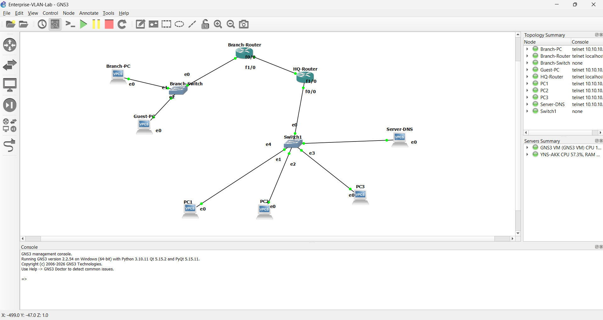
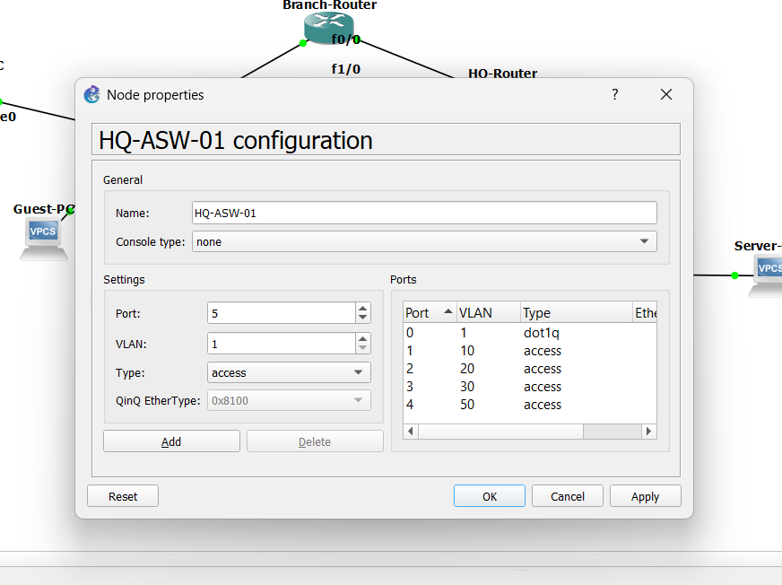
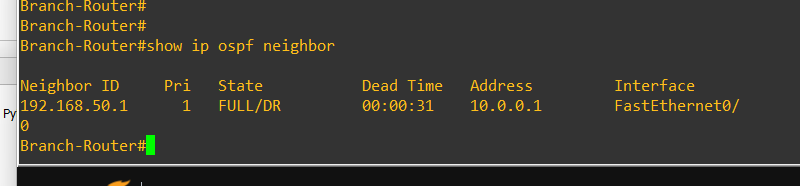

# Multi-Site Enterprise Network with VLANs and OSPF

A two-site network built in GNS3: a headquarters and a branch office, connected by a point-to-point WAN link. Router-on-a-stick (802.1Q) provides inter-VLAN routing, and OSPF exchanges routes between the sites. Clients and the server are simulated with VPCS nodes.

> **Status:** VLANs, inter-VLAN routing and OSPF are configured, and the OSPF adjacency reaches the FULL state. The GNS3 configuration has no traffic filtering yet. An automated [concept retest](#concept-retest) with FRRouting verifies connectivity, the PC3 fix and ACL rules. They have not been applied in GNS3 yet. See [Known limitations](#known-limitations).

> **Kurzfassung (DE):** Unternehmensnetz in GNS3 mit Hauptsitz und Filiale: fünf getrennte VLANs, Inter-VLAN-Routing per Router-on-a-Stick, /30-WAN-Strecke und dynamisches Routing mit OSPF. Die OSPF-Nachbarschaft erreicht den Status FULL. Ein automatisierter Nachtest mit FRRouting bestätigt Verbindungen, die PC3-Korrektur und Filterregeln. In GNS3 auf Cisco-Routern stehen sie noch aus.

## Topology



## IP addressing

| Site | Network role | VLAN | Subnet | Gateway | Node |
|---|---|---|---|---|---|
| HQ | Management clients | 10 | 192.168.10.0/24 | 192.168.10.1 | 192.168.10.10 (PC1) |
| HQ | Staff / HR | 20 | 192.168.20.0/24 | 192.168.20.1 | 192.168.20.10 (PC2) |
| HQ | Server zone (planned DMZ) | 50 | 192.168.50.0/24 | 192.168.50.1 | 192.168.50.10 (Server-DNS) |
| Branch | Remote office staff | 30 | 192.168.30.0/24 | 192.168.30.1 | 192.168.30.20 (Branch-PC) |
| Branch | Guest network | 40 | 192.168.40.0/24 | 192.168.40.1 | 192.168.40.10 (Guest-PC) |
| WAN | Inter-router link | n/a | 10.0.0.0/30 | Point-to-point | 10.0.0.1 (HQ), 10.0.0.2 (Branch) |

## Switch ports



### Headquarters switch (HQ-ASW-01)

| Port | Mode | Connected to |
|---|---|---|
| e0 | 802.1Q trunk | HQ-Router (f0/0) |
| e1 | Access, VLAN 10 | Management workstation |
| e2 | Access, VLAN 20 | Staff workstation |
| e3 | Access, VLAN 30 | PC3 (see [Known limitations](#known-limitations)) |
| e4 | Access, VLAN 50 | Server-DNS node |

### Branch switch (BR-ASW-01)

| Port | Mode | Connected to |
|---|---|---|
| e0 | 802.1Q trunk | Branch-Router (f1/0) |
| e1 | Access, VLAN 40 | Guest-PC |
| e2 | Access, VLAN 30 | Branch employee workstation |

## Router configuration

### HQ-Router

```text
enable
configure terminal
hostname HQ-Router

interface FastEthernet0/0
 no shutdown
exit

interface FastEthernet0/0.10
 description HQ_Management_VLAN_10
 encapsulation dot1Q 10
 ip address 192.168.10.1 255.255.255.0
exit

interface FastEthernet0/0.20
 description HQ_Staff_VLAN_20
 encapsulation dot1Q 20
 ip address 192.168.20.1 255.255.255.0
exit

interface FastEthernet0/0.50
 description HQ_Secure_DMZ_VLAN_50
 encapsulation dot1Q 50
 ip address 192.168.50.1 255.255.255.0
exit

interface FastEthernet1/0
 description WAN_Backbone_To_Branch
 ip address 10.0.0.1 255.255.255.252
 no shutdown
exit

router ospf 1
 log-adjacency-changes
 network 192.168.10.0 0.0.0.255 area 0
 network 192.168.20.0 0.0.0.255 area 0
 network 192.168.50.0 0.0.0.255 area 0
 network 10.0.0.0 0.0.0.3 area 0
end
write memory
```

### Branch-Router

```text
enable
configure terminal
hostname Branch-Router

interface FastEthernet1/0
 no shutdown
exit

interface FastEthernet1/0.30
 description Branch_Staff_VLAN_30
 encapsulation dot1Q 30
 ip address 192.168.30.1 255.255.255.0
exit

interface FastEthernet1/0.40
 description Branch_Guests_VLAN_40
 encapsulation dot1Q 40
 ip address 192.168.40.1 255.255.255.0
exit

interface FastEthernet0/0
 description WAN_Backbone_To_HQ
 ip address 10.0.0.2 255.255.255.252
 no shutdown
exit

router ospf 1
 log-adjacency-changes
 network 192.168.30.0 0.0.0.255 area 0
 network 192.168.40.0 0.0.0.255 area 0
 network 10.0.0.0 0.0.0.3 area 0
end
write memory
```

## Verification

**OSPF adjacency:** Branch-Router shows neighbor 192.168.50.1 in the FULL/DR state via FastEthernet0/0.



## Concept retest

An automated retest on GitHub Actions rebuilds the design with the same addressing. **FRRouting, Linux bridges and iptables stand in for the Cisco routers, the switches and ACLs**, so it checks the design, not the IOS configuration above.

Two changes compared with the GNS3 lab: PC3 moves to a new VLAN 60 (192.168.60.0/24) with a gateway on the HQ router, and the guest network and server zone are filtered.

| Check | Result |
|---|---|
| OSPF adjacency | Full |
| PC3 reaches its gateway and Branch-PC | Yes |
| PC1 reaches PC2 and Branch-PC | Yes |
| Guest-PC reaches PC1 and the server, without ACLs | Yes |
| Guest-PC reaches PC1, Branch-PC or the server, with ACLs | No |
| PC1 reaches the server on TCP 53, with ACLs | Yes |
| PC1 reaches the server on port 80, with ACLs | No |

All 13 checks passed. See the [results](retest/evidence/results.txt), [evidence](retest/evidence/) and [workflow](.github/workflows/retest.yml). The retest was built and run with AI assistance (Claude).

## Known limitations

- **No traffic filtering yet:** The configuration contains no ACLs. All subnets are in OSPF area 0, so the guest network and the server zone can be reached from the other VLANs. The VLANs are separate broadcast domains, but the server zone is not yet a real DMZ and the guest network is not isolated.
- **No redundancy:** The sites are connected by a single WAN link and a single router on each side.
- **VLAN 30 at HQ:** Port e3 is assigned to VLAN 30, but the HQ router has no VLAN 30 sub-interface, so PC3 has no gateway at HQ.
- **Verification so far:** In GNS3, the OSPF neighbor state is documented. End-to-end tests exist only in the concept retest.

## Next steps

1. Apply the ACLs and the PC3 fix from the concept retest on the Cisco routers in GNS3
2. Document ping tests between VLANs and sites there, with and without the ACLs
